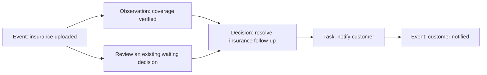

# Decision Schema

**A shared data model for recording what happened, what is known, what was decided, and what happens next.**

Version 0.1 · Draft · Created by [Kevin Simper](https://github.com/kevinsimper)

AI makes adding features cheap. Keeping those features understandable together is harder.

A document feature gets reminders, a workshop feature gets follow-ups, and a customer feature gets its own agent notes. Each works independently. But when a customer asks, “Can this vehicle return to service?”, an agent needs to connect all three: the insurance document, the inspection, and the outstanding work.

Decision Schema gives those features the same five tables for evidence, judgment, and execution. Domain tables still hold vehicles, documents, and bookings. The shared layer makes their decisions and follow-up work discoverable through one predictable structure.

## Five tables, shared across features

| Table          | Question                                          | Example                                                     |
| -------------- | ------------------------------------------------- | ----------------------------------------------------------- |
| `events`       | What happened?                                    | The customer uploaded insurance.                            |
| `event_lines`  | What moved?                                       | One printer moved from the workshop to a vehicle.           |
| `observations` | What do we know or believe?                       | The uploaded insurance covers this vehicle.                 |
| `decisions`    | What should we do, and when should we reconsider? | Wait until tomorrow, or review sooner if insurance arrives. |
| `tasks`        | Who or what needs to act?                         | Ask an operator to verify the document.                     |

The tables are shared by the application, rather than recreated for every feature. Events without a movement have no event lines.

## A decision that knows when to come back

An agent records:

> **Decision:** Wait for the customer's insurance.
>
> **Rationale:** The customer promised to upload it tomorrow.
>
> **Review at:** Tomorrow at 09:00.
>
> **Review on event:** `insurance.uploaded` for this vehicle.

If the document arrives today, that event makes the decision due for review. The agent checks the document and records a new decision that supersedes the first. If nothing arrives, the scheduled review still happens.

The old decision remains in history. A new agent can find the evidence, understand the stated rationale, and see what work remains without reading the original conversation.

This is a common flow, not a required pipeline: an event can trigger review directly, and a decision to wait need not create a task.

## Read the standard

- [Current specification](spec.md) — the stable entry point.
- [Version 0.1](0.1.md) — fields, relationships, review semantics, and conformance.
- [Worked examples](examples.md) — insurance, workshop inspection, and equipment transfer using the same model.
- [Implementation guide](implementation.md) — practical adoption and reliable execution.
- [Contributing](CONTRIBUTING.md) and [revision history](CHANGELOG.md).

The intended audience is application developers building systems where humans and agents share operational decisions. This first publication defines a logical model and worked examples; it does not ship a database implementation or SDK. Version 0.1 is open for feedback and may change before 1.0.

## Why a shared structure matters

An agent can ask the same questions across features:

- What changed for this subject?
- Which observations remain current, and what supports them?
- What is the current decision for each concern?
- Which decisions need review, and why?
- Which tasks remain, and which decisions justify them?

Shared subject references connect the records. Explicit types and documented payloads retain business meaning. Authorization and domain rules still apply: a common schema does not by itself grant access or make an agent competent in every domain.

## Relationship to Activity Schema

[Activity Schema](https://github.com/ActivitySchema/ActivitySchema), created by Ahmed Elsamadisi at Narrator, inspired this approach: a consistent data structure makes queries and tools reusable across business concepts. Its [2.0 specification](https://github.com/ActivitySchema/ActivitySchema/blob/main/2.0.md) describes a model for warehouse analysis.

Decision Schema applies that design principle to operational evidence, decisions, reevaluation, and work. It uses explicit references between records and complements existing domain tables. It does not require Activity Schema or define a compatible Activity Schema stream.

## Origins and license

Created by Kevin Simper from work on shared operational models for humans and agents. The first draft develops the ideas of events, movement ledgers, observations, decisions, and tasks into a public specification. The examples are fictional; this publication makes no claim of production conformance.

Copyright 2026 Kevin Simper. Licensed under [Apache-2.0](LICENSE).
